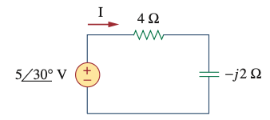
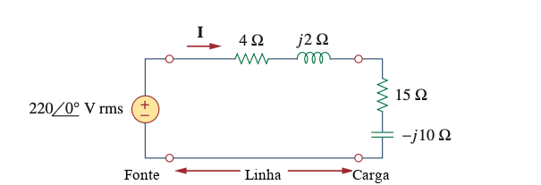

```{r setup, include=FALSE}
# Habilita circuitikz (diagrama do capacitor de correção) nos chunks
# {tikz} desta aula.
knitr::opts_chunk$set(engine.opts = list(
  extra.preamble = c("\\usepackage{circuitikz}"),
  classoption = "tikz,multi=circuitikz"
))
```

## Potência em CC × potência em CA {.no-crumb}

:::: {.columns}
::: {.column width="50%"}
**Corrente contínua**

```{tikz}
%| echo: false
%| fig-align: center
%| fig-width: 4
%| out-width: "42%"
\input{imgs/tikz/FonteCCCarga.tikz}
```

::: {.eqx}
$$p = V\,I \quad \text{(constante)}$$
:::

[Fluxo **constante**, da fonte para a carga.]{.muted}
:::
::: {.column width="50%"}
**Corrente alternada**

```{tikz}
%| echo: false
%| fig-align: center
%| fig-width: 4
%| out-width: "42%"
\input{imgs/tikz/FonteCACarga.tikz}
```

::: {.eqx}
$$p(t) = v(t)\,i(t) = \;?$$
:::

[$v(t)$ e $i(t)$ oscilam, em geral **defasadas**.]{.muted}
:::
::::

::: {.takeaway .fragment}
E em CA: como a energia vai da fonte para a carga?
:::

::: {.notes}
Aula de ~100 min. Roteiro: p(t) (25) · valor eficaz (10) · P e Q (20) · potência complexa (15) · fator de potência (10) · correção (15) · síntese (5).
Deixe a pergunta no ar: ela é respondida no gráfico de p(t) e no slide das parcelas ativa e reativa.
:::

# Potência instantânea

- Perguntas
- Produto de cossenos
- Dedução de $p(t)$
- Gráfico

## O que queremos saber

::: {.lead}
Com $v(t) = V_m\cos(\omega t+\theta_v)$ e $i(t) = I_m\cos(\omega t+\theta_i)$:
:::

1. Quanta energia a fonte entrega, **em média**, à carga?
2. Parte da energia **volta** para a fonte?
3. Qual o papel da **defasagem** $\theta_v-\theta_i$?

::: {.takeaway .fragment}
O ponto de partida é o produto $v(t)\,i(t)$: um produto de dois cossenos.
:::

## Produto de dois cossenos

::: {.eqx .deriv style="--deriv-lhs: 300px; --deriv-rhs: 740px;"}
::: {.step}
[$\cos(A+B)$]{.lhs} [$= \cos A\cos B - \sin A\sin B$]{.rhs} [cosseno da soma]{.why}
:::
::: {.step .fragment}
[$\cos(A-B)$]{.lhs} [$= \cos A\cos B + \sin A\sin B$]{.rhs} [cosseno da diferença]{.why}
:::
::: {.step .fragment}
[$2\cos A\cos B$]{.lhs} [$= \cos(A-B)+\cos(A+B)$]{.rhs} [somando: os senos se cancelam]{.why}
:::
::: {.step .fragment}
[$\cos A\cos B$]{.lhs} [$= \tfrac12\big[\eq{a}{\cos(A-B)} + \eq{b}{\cos(A+B)}\big]$]{.rhs} [identidade produto-soma]{.why}
:::
:::

::: {.eqx .fragment}
Em $p(t) = v(t)\,i(t)$:

- $A = \omega t+\theta_v$ e $B = \omega t+\theta_i$
- $\eq{a}{A-B = \theta_v-\theta_i}$: **não depende** de $t$
- $\eq{b}{A+B = 2\omega t+\theta_v+\theta_i}$: frequência **dobrada**
:::

## Dedução de $p(t)$

::: {.eqx .deriv style="--deriv-lhs: 110px; --deriv-rhs: 980px;"}
::: {.step}
[$p(t)$]{.lhs} [$= v(t)\,i(t)$]{.rhs} [definição]{.why}
:::
::: {.step .fragment}
[$p(t)$]{.lhs} [$= V_m I_m \cos(\omega t+\theta_v)\cos(\omega t+\theta_i)$]{.rhs} [senoides de tensão e corrente]{.why}
:::
::: {.step .fragment}
[$p(t)$]{.lhs} [$= \tfrac{1}{2}V_m I_m\left[\cos(\theta_v-\theta_i) + \cos(2\omega t+\theta_v+\theta_i)\right]$]{.rhs} [produto de cossenos]{.why}
:::
::: {.step .fragment}
[$p(t)$]{.lhs} [$= \eq{a}{\tfrac12 V_m I_m\cos\theta} + \eq{b}{\tfrac12 V_m I_m\cos(2\omega t+\theta_v+\theta_i)}$]{.rhs} [$\theta = \theta_v-\theta_i$]{.why}
:::
:::

::: {.takeaway .fragment}
[parcela **constante**]{.t-a} + [parcela que oscila no **dobro** da frequência]{.t-b}
:::

## $p(t)$ ao vivo

::: {style="height: 640px"}
<canvas class="nova-canvas" data-nova-anim="potencia-instantanea" data-controls="theta"></canvas>
:::

::: {.notes}
Responde às perguntas do início. Comece em θ = 0 (resistor: p ≥ 0 sempre, média máxima), depois ±90° (indutor/capacitor: média nula, metade do tempo a energia volta) e termine em 60°, o caso do exemplo numérico.
:::

# Valor eficaz

- Definição
- Senoide

## Valor eficaz (RMS)

::: {.lead}
Que tensão **constante** $V_{ef}$ entregaria a um resistor a mesma potência média que uma tensão periódica $v(t)$?
:::

::: {.eqx}
$$
\frac{V_{ef}^2}{R} = \frac{1}{T}\int_0^T \frac{v^2(t)}{R}\,dt
\qquad\Longrightarrow\qquad
\eq{a}{V_{ef}} = \sqrt{\eq{b}{\tfrac{1}{T}\textstyle\int_0^T} \eq{c}{v^2(t)}\,dt}
$$

::: {.eqx-text}
[Raiz]{.t-a .fragment .lightup} da [média]{.t-b .fragment .lightup} do [quadrado]{.t-c .fragment .lightup}: *root mean square* (RMS).
:::
:::

::: {.takeaway .fragment}
Vale para **qualquer** sinal periódico, de tensão ou de corrente.
:::

## Valor eficaz de uma senoide

::: {.eqx .deriv style="--deriv-lhs: 120px; --deriv-rhs: 780px;"}
::: {.step}
[$V_{rms}^2$]{.lhs} [$= \dfrac{1}{T}\displaystyle\int_0^T V_m^2\cos^2(\omega t+\theta_v)\,dt$]{.rhs} [definição]{.why}
:::
::: {.step .fragment}
[$V_{rms}^2$]{.lhs} [$= \dfrac{V_m^2}{T}\displaystyle\int_0^T \tfrac12\big[1+\cos(2\omega t+2\theta_v)\big]\,dt$]{.rhs} [produto de cossenos com $A=B$]{.why}
:::
::: {.step .fragment}
[$V_{rms}^2$]{.lhs} [$= \dfrac{V_m^2}{2}$]{.rhs} [o cosseno tem média nula no período]{.why}
:::
::: {.step .fragment}
[$V_{rms}$]{.lhs} [$= \dfrac{V_m}{\sqrt2} \approx 0{,}707\,V_m$]{.rhs} [idem para $I_{rms} = I_m/\sqrt2$]{.why}
:::
:::

::: {.takeaway .fragment}
Os 127 V da tomada são valor **eficaz**: o pico é $127\sqrt2 \approx 180$ V.
:::

# Potências ativa e reativa

- Duas parcelas
- Potência média
- Potência reativa
- R, L e C

## Separando $p(t)$ em duas parcelas

::: {.eqx}
$$
\begin{aligned}
p(t) &= V_{rms}I_{rms}\cos\theta + V_{rms}I_{rms}\cos(2\omega t+2\theta_i+\theta)\\[8pt]
     &= \eq{a}{V_{rms}I_{rms}\cos\theta}\,\big[1+\cos(2\omega t+2\theta_i)\big] - \eq{b}{V_{rms}I_{rms}\sin\theta}\,\sin(2\omega t+2\theta_i)
\end{aligned}
$$
:::

[Usando $\tfrac12 V_mI_m = V_{rms}I_{rms}$, $\;\theta_v+\theta_i = 2\theta_i+\theta\;$ e o cosseno da soma.]{.muted .smaller}

:::: {.columns}
::: {.column width="50%" .fragment}
[**Parcela ativa**]{.t-a}

Amplitude $\propto\cos\theta$, **nunca negativa**: energia entregue à carga.
:::
::: {.column width="50%" .fragment}
[**Parcela reativa**]{.t-b}

Amplitude $\propto\sin\theta$, **média nula**: energia que vai e volta.
:::
::::

## As duas parcelas no tempo

::: {style="height: 640px"}
<canvas class="nova-canvas" data-nova-anim="pt-ativa-reativa" data-controls="theta"></canvas>
:::

::: {.notes}
θ = 0: só a parcela ativa (resistor). θ = ±90°: só a reativa, média nula (indutor/capacitor). Em 60°, mostre que a soma reproduz o p(t) do gráfico anterior.
:::

## Potência média (ativa)

::: {.eqx}
$$
P = \frac{1}{T}\int_0^T p(t)\,dt = \eq{a}{V_{rms}I_{rms}\cos\theta} = \tfrac12 V_m I_m\cos(\theta_v-\theta_i) \qquad [\text{W}]
$$
:::

[A parcela reativa e a oscilação da ativa têm média nula: só sobra a amplitude da parcela ativa.]{.muted}

::: {.takeaway .fragment}
$P$ é a única parcela que realiza **trabalho útil** (calor, torque, luz) e a que se paga em kWh.
:::

## Exemplo: potência média

:::: {.columns}
::: {.column width="50%"}
{width="100%"}
:::
::: {.column width="50%"}
::: {.lead}
Calcule a potência média **fornecida pela fonte** e a **absorvida** pelo resistor e pelo capacitor.
:::

[Fasores em amplitude de pico, como em @alexander2013fundamentos.]{.muted .smaller}
:::
::::

::: {.callout-question .fragment}
Antes de calcular: qual elemento **não** absorve potência média? Por quê?
:::

## Exemplo: solução

::: {.eqx .deriv style="--deriv-lhs: 170px; --deriv-rhs: 1010px;"}
::: {.step}
[$\mathbf{Z}$]{.lhs} [$= 4 - j2 = 4{,}472\angle{-26{,}57°}\ \Omega$]{.rhs} [impedância série]{.why}
:::
::: {.step .fragment}
[$\mathbf{I}$]{.lhs} [$= 5\angle 30° \,/\, 4{,}472\angle{-26{,}57°} = 1{,}118\angle 56{,}57°\ \text{A}$]{.rhs} [lei de Ohm]{.why}
:::
::: {.step .fragment}
[$P_{fonte}$]{.lhs} [$= \tfrac12\,(5)(1{,}118)\cos(30° - 56{,}57°) = \eq{a}{2{,}5\ \text{W}}$]{.rhs} [$\tfrac12 V_mI_m\cos(\theta_v-\theta_i)$]{.why}
:::
::: {.step .fragment}
[$P_R$]{.lhs} [$= \tfrac12\,(1{,}118)^2\,(4) = \eq{a}{2{,}5\ \text{W}}$]{.rhs} [$\tfrac12 I_m^2 R$]{.why}
:::
::: {.step .fragment}
[$P_C$]{.lhs} [$= \tfrac12\,V_{Cm} I_m\cos(-90°) = 0$]{.rhs} [$V$ e $I$ em quadratura]{.why}
:::
:::

::: {.takeaway .fragment}
$P_{fonte} = P_R + P_C$: os 2,5 W da fonte vão todos para o resistor.
:::

## Potência reativa

::: {.eqx}
$$
Q = \eq{b}{V_{rms}I_{rms}\sin\theta} = \tfrac12 V_m I_m\sin(\theta_v-\theta_i) \qquad [\text{var}]
$$
:::

::: {.callout-insight .fragment title="Não é consumo"}
$Q$ **não** representa energia consumida: é a amplitude da **troca** de energia entre a fonte e os campos elétrico e magnético de capacitores e indutores.
:::

## Resistor, indutor e capacitor

::: {style="height: 660px"}
<canvas class="nova-canvas" data-nova-anim="fasores-rlc"></canvas>
:::

::: {.notes}
Fasores alinhados (R): p(t) nunca negativa. Fasores ortogonais (L e C): p(t) tem média nula, metade do ciclo a energia volta. O sinal de Q distingue indutor (absorve reativo) de capacitor (fornece reativo): é a base da correção do fator de potência.
:::

# Potência complexa

- Aparente
- Complexa
- Triângulo
- Conservação

## Potência aparente e potência complexa

::: {.eqx .deriv style="--deriv-lhs: 60px; --deriv-rhs: 1040px;"}
::: {.step}
[$S$]{.lhs} [$= V_{rms}I_{rms} \quad [\text{VA}]$]{.rhs} [aparente: ignora a defasagem]{.why}
:::
::: {.step .fragment}
[$\mathbf{S}$]{.lhs} [$= \mathbf{V}_{rms}\,\mathbf{I}_{rms}^{*} = \tfrac12\,\mathbf{V}\mathbf{I}^{*}$]{.rhs} [complexa: usa o conjugado da corrente]{.why}
:::
::: {.step .fragment}
[$\mathbf{S}$]{.lhs} [$= V_{rms}\angle\theta_v \cdot I_{rms}\angle{-\theta_i} = V_{rms}I_{rms}\angle(\theta_v-\theta_i)$]{.rhs} [produto na forma polar]{.why}
:::
::: {.step .fragment}
[$\mathbf{S}$]{.lhs} [$= \eq{a}{V_{rms}I_{rms}\cos\theta} + j\,\eq{b}{V_{rms}I_{rms}\sin\theta} = \eq{a}{P} + j\,\eq{b}{Q}$]{.rhs} [Euler]{.why}
:::
:::

::: {.takeaway .fragment}
$|\mathbf{S}| = S$ e $\angle\mathbf{S} = \theta$: um só número complexo guarda [$P$]{.t-a} e [$Q$]{.t-b}.
:::

## Formas equivalentes de $\mathbf{S}$

::: {.eqx .deriv style="--deriv-lhs: 80px; --deriv-rhs: 920px;"}
::: {.step}
[$\mathbf{S}$]{.lhs} [$= \mathbf{V}_{rms}\,\mathbf{I}_{rms}^{*}$]{.rhs} [definição]{.why}
:::
::: {.step .fragment}
[$\mathbf{S}$]{.lhs} [$= (\mathbf{Z}\,\mathbf{I}_{rms})\,\mathbf{I}_{rms}^{*}$]{.rhs} [lei de Ohm: $\mathbf{V}_{rms} = \mathbf{Z}\,\mathbf{I}_{rms}$]{.why}
:::
::: {.step .fragment}
[$\mathbf{S}$]{.lhs} [$= \mathbf{Z}\,|\mathbf{I}_{rms}|^2 = \mathbf{Z}\,I_{rms}^2$]{.rhs} [$z\,z^{*} = |z|^2$, um número real]{.why}
:::
::: {.step .fragment}
[$\mathbf{S}$]{.lhs} [$= (R+jX)\,I_{rms}^2 = \eq{a}{R\,I_{rms}^2} + j\,\eq{b}{X\,I_{rms}^2}$]{.rhs} [$\mathbf{Z} = R + jX$]{.why}
:::
:::

::: {.takeaway .fragment}
[$P = R\,I_{rms}^2$]{.t-a} vem só da **resistência**; [$Q = X\,I_{rms}^2$]{.t-b}, só da **reatância**.
:::

::: {.muted .smaller .fragment}
Em função da tensão, com $\mathbf{I}_{rms} = \mathbf{V}_{rms}/\mathbf{Z}$: $\;\mathbf{S} = \mathbf{V}_{rms}\left(\dfrac{\mathbf{V}_{rms}}{\mathbf{Z}}\right)^{*} = \dfrac{V_{rms}^2}{\mathbf{Z}^{*}}$.
:::

## Triângulo de potências

:::: {.columns}
::: {.column width="55%"}
```{tikz}
%| echo: false
%| fig-align: center
%| fig-width: 7
\input{imgs/tikz/TrianguloPotencias.tikz}
```
:::
::: {.column width="45%"}
$$
\begin{aligned}
S &= \sqrt{P^2+Q^2}\\[4pt]
\theta &= \arctan\frac{Q}{P}\\[4pt]
P &= S\cos\theta\\[4pt]
Q &= S\sin\theta
\end{aligned}
$$
:::
::::

::: {.takeaway .fragment}
O ângulo $\theta$ do triângulo é o mesmo $\theta_v-\theta_i$ de $p(t)$, $P$ e $Q$.
:::

## Conservação da potência complexa

::: {.lead}
Num circuito, a potência complexa fornecida pelas fontes é igual à soma das absorvidas pelas cargas, em série ou em paralelo.
:::

::: {.eqx}
$$
\mathbf{S}_{\text{fonte}} = \sum_k \mathbf{S}_k
\qquad\Longrightarrow\qquad
P = \sum_k P_k, \qquad Q = \sum_k Q_k
$$
:::

::: {.callout-note .fragment title="Cuidado"}
A potência **aparente** não se conserva: $S \neq \sum_k S_k$ em geral, porque os módulos não se somam.
:::

## Exemplo: linha de transmissão

:::: {.columns}
::: {.column width="60%"}
{width="100%"}
:::
::: {.column width="40%"}
Uma carga é alimentada por uma fonte de tensão através de uma linha de transmissão, representada pela impedância $(4 + j2)\ \Omega$ (inclui o caminho de retorno).

Determine as potências **ativa** e **reativa** absorvidas:

a) pela fonte;
b) pela linha;
c) pela carga.
:::
::::

[Adaptado de @alexander2013fundamentos. Fasor em valor **eficaz**: $\mathbf{S} = \mathbf{V}_{rms}\mathbf{I}_{rms}^{*}$, sem o fator $\tfrac12$.]{.muted .smaller}

## Exemplo: solução

::: {.eqx .deriv style="--deriv-lhs: 190px; --deriv-rhs: 1150px;"}
::: {.step}
[$\mathbf{Z}$]{.lhs} [$= 19 - j8 = 20{,}62\angle{-22{,}83°}\ \Omega$ (série)]{.rhs}
:::
::: {.step .fragment}
[$\mathbf{I}$]{.lhs} [$= 220\angle 0° / 20{,}62\angle{-22{,}83°} = 10{,}67\angle 22{,}83°$ A]{.rhs}
:::
::: {.step .fragment}
[$\mathbf{S}_{linha}$]{.lhs} [$= 113{,}9\,(4+j2) = \eq{a}{455{,}5} + j\eq{b}{227{,}8}$ VA]{.rhs}
:::
::: {.step .fragment}
[$\mathbf{S}_{carga}$]{.lhs} [$= 113{,}9\,(15-j10) = \eq{a}{1708{,}2} - j\eq{b}{1138{,}8}$ VA]{.rhs}
:::
::: {.step .fragment}
[$\mathbf{S}_{fonte}$]{.lhs} [$= -\mathbf{V}\mathbf{I}^{*} = \eq{a}{-2163{,}8} + j\eq{b}{911{,}1}$ VA]{.rhs}
:::
:::

::: {.takeaway .fragment}
$\mathbf{S}_{fonte} + \mathbf{S}_{linha} + \mathbf{S}_{carga} = 0$: a potência complexa se conserva.
:::

[$I_{rms}^2 = 113{,}9$ A². Na fonte, $\mathbf{I}$ sai pelo terminal $+$: a potência absorvida tem sinal negativo (ela **fornece** 2163,8 W).]{.muted .smaller}

# Fator de potência

- Ângulo da impedância
- Definição
- Exemplo

## $\theta$ é o ângulo da impedância

::: {.eqx .deriv style="--deriv-lhs: 110px; --deriv-rhs: 760px;"}
::: {.step}
[$\mathbf{Z}$]{.lhs} [$= \mathbf{V}/\mathbf{I} = \tfrac{V_m\angle\theta_v}{I_m\angle\theta_i}$]{.rhs} [lei de Ohm fasorial]{.why}
:::
::: {.step .fragment}
[$\mathbf{Z}$]{.lhs} [$= \tfrac{V_m}{I_m}\angle(\eq{a}{\theta_v-\theta_i})$]{.rhs} [na divisão, os ângulos se subtraem]{.why}
:::
::: {.step .fragment}
[$\theta_Z$]{.lhs} [$= \eq{a}{\theta_v-\theta_i} = \theta$]{.rhs} [o ângulo de $p(t)$, $P$ e $Q$]{.why}
:::
:::

::: {.smaller}
| Carga | $\mathbf{Z}$ | $\theta_Z$ |
|:--|:--:|:--:|
| Resistor | $R$ | $0°$ |
| Indutor | $j\omega L$ | $+90°$ |
| Capacitor | $1/(j\omega C) = -j/(\omega C)$ | $-90°$ |

: {tbl-colwidths="[30,45,25]"}
:::

::: {.takeaway .fragment}
$\theta$ depende **só da carga**: é a impedância que fixa $P$ e $Q$.
:::

## Fator de potência

::: {.callout-definition title="Fator de potência"}
Razão entre a potência ativa e a aparente:
$$\text{fp} = \frac{P}{S} = \cos\theta$$
:::

[Como $\cos\theta$ é par, o fp sozinho não diz se a corrente adianta ou atrasa: por isso ele é sempre **qualificado**.]{.muted}

| Natureza | Condição | Corrente em relação à tensão |
|:--|:--:|:--|
| **Atrasado** (indutivo) | $\theta>0$ | **atrasa**: motores, transformadores |
| **Adiantado** (capacitivo) | $\theta<0$ | **adianta**: bancos de capacitores |
| **Unitário** | $\theta=0$ | em fase: carga puramente resistiva |

: {tbl-colwidths="[28,16,56]"}

## Exemplo numérico

[$v(t) = 170\cos(\omega t)$ V e $i(t) = 10\cos(\omega t-60°)$ A, o mesmo caso da animação de $p(t)$.]{.muted}

::: {.eqx .deriv style="--deriv-lhs: 140px; --deriv-rhs: 860px;"}
::: {.step}
[$V_{rms}$]{.lhs} [$= 170/\sqrt2 = 120{,}2\ \text{V}$]{.rhs} [valor eficaz da tensão]{.why}
:::
::: {.step .fragment}
[$I_{rms}$]{.lhs} [$= 10/\sqrt2 = 7{,}07\ \text{A}$]{.rhs} [valor eficaz da corrente]{.why}
:::
::: {.step .fragment}
[$\theta$]{.lhs} [$= 0-(-60°) = 60°$]{.rhs} [$\theta_v-\theta_i$]{.why}
:::
::: {.step .fragment}
[$P$]{.lhs} [$= 850\cos 60° = \eq{a}{425\ \text{W}}$]{.rhs} [$V_{rms}I_{rms} = 850$ VA]{.why}
:::
::: {.step .fragment}
[$Q$]{.lhs} [$= 850\sin 60° = \eq{b}{736{,}1\ \text{var}}$]{.rhs} [$\sin 60° = 0{,}866$]{.why}
:::
::: {.step .fragment}
[$\mathbf{S}$]{.lhs} [$= 425 + j\,736{,}1 = 850\angle 60°\ \text{VA}$]{.rhs} [potência complexa]{.why}
:::
::: {.step .fragment}
[fp]{.lhs} [$= 425/850 = 0{,}5$ atrasado]{.rhs} [$\theta>0$: carga indutiva]{.why}
:::
:::

## Exemplo: cargas em paralelo

:::: {.columns}
::: {.column width="50%"}
```{tikz}
%| echo: false
%| fig-align: center
%| fig-width: 5
%| out-width: "80%"
\input{imgs/tikz/ExemploCargasParalelo.tikz}
```
:::
::: {.column width="50%"}
Com $\mathbf{Z}_1 = 60\angle{-30°}\ \Omega$ e $\mathbf{Z}_2 = 40\angle 45°\ \Omega$, calcule, para o conjunto visto pela fonte:

a) a potência aparente;
b) a potência ativa;
c) a potência reativa;
d) o fator de potência.
:::
::::

[Adaptado de @alexander2013fundamentos. Fasores em valor eficaz.]{.muted .smaller}

## Exemplo: solução

::: {.eqx .deriv style="--deriv-lhs: 130px; --deriv-rhs: 1300px;"}
::: {.step}
[$\mathbf{S}_1$]{.lhs} [$= \dfrac{V_{rms}^2}{\mathbf{Z}_1^{*}} = \dfrac{120^2}{60\angle 30°} = 240\angle{-30°} = 207{,}8 - j120\ \text{VA}$]{.rhs}
:::
::: {.step .fragment}
[$\mathbf{S}_2$]{.lhs} [$= \dfrac{V_{rms}^2}{\mathbf{Z}_2^{*}} = \dfrac{120^2}{40\angle{-45°}} = 360\angle 45° = 254{,}6 + j254{,}6\ \text{VA}$]{.rhs}
:::
::: {.step .fragment}
[$\mathbf{S}$]{.lhs} [$= \mathbf{S}_1 + \mathbf{S}_2 = \eq{a}{462{,}4} + j\,\eq{b}{134{,}6} = 481{,}6\angle 16{,}22°\ \text{VA}$]{.rhs}
:::
::: {.step .fragment}
[fp]{.lhs} [$= \cos 16{,}22° = 0{,}96$ atrasado ($\theta > 0$: indutivo)]{.rhs}
:::
:::

::: {.takeaway .fragment}
$S = 481{,}6$ VA, $\;P = 462{,}4$ W, $\;Q = 134{,}6$ var, $\;$fp $= 0{,}96$ atrasado.
:::

# Correção do fator de potência

- Motivação
- Método
- Simulação
- Exemplo

## Por que corrigir? {.nostretch}

:::: {.columns}
::: {.column width="48%"}
- Fp baixo exige **mais corrente** para entregar a mesma $P$: mais perdas $R\,I^2$ na fiação e condutores e transformadores maiores.
- A concessionária **cobra** o excedente de reativo quando o fp fica abaixo de **0,92** (ANEEL).
:::
::: {.column width="52%"}
```{tikz}
%| echo: false
%| fig-align: center
%| fig-width: 9
\input{imgs/tikz/CircuitoCorrecaoFP.tikz}
```
:::
::::

::: {.takeaway .fragment}
Solução: um **banco de capacitores em paralelo** com a carga fornece localmente parte do reativo, sem alterar $P$ nem a tensão na carga.
:::

## O método

::: {.eqx .deriv style="--deriv-lhs: 120px; --deriv-rhs: 760px;"}
::: {.step}
[$Q_1$]{.lhs} [$= P\tan\theta_1$]{.rhs} [reativo antes, com $\theta_1 = \arccos \text{fp}_1$]{.why}
:::
::: {.step .fragment}
[$Q_2$]{.lhs} [$= P\tan\theta_2$]{.rhs} [reativo desejado, com o mesmo $P$]{.why}
:::
::: {.step .fragment}
[$Q_c$]{.lhs} [$= Q_1-Q_2 = \eq{e}{P\,(\tan\theta_1-\tan\theta_2)}$]{.rhs} [o capacitor fornece a diferença]{.why}
:::
::: {.step .fragment}
[$C$]{.lhs} [$= \dfrac{\eq{e}{Q_c}}{\omega V_{rms}^2}$]{.rhs} [$Q_c = V_{rms}^2/X_C = \omega C V_{rms}^2$]{.why}
:::
:::

::: {.takeaway .fragment}
O capacitor **não altera $P$**: ele só encurta o cateto $Q$ e, com ele, a hipotenusa $S$.
:::

## Correção ao vivo

::: {style="height: 640px"}
<canvas class="nova-canvas" data-nova-anim="correcao-fp" data-controls="fp1,fp2" data-p="1200" data-v="220"></canvas>
:::

::: {.notes}
Valores iniciais = exemplo do próximo slide (1200 W, 220 V, 0,75 → 0,95). Mostre que levar o fp de 0,95 a 1,00 exige quase tanto capacitor quanto de 0,75 a 0,95: por isso não se corrige até o unitário.
:::

## Exemplo numérico

[Carga de $P = 1200$ W, fp$_1 = 0{,}75$ atrasado, $V_{rms} = 220$ V, $f = 60$ Hz. Corrigir para fp$_2 = 0{,}95$ atrasado.]{.muted}

::: {.eqx .deriv style="--deriv-lhs: 100px; --deriv-rhs: 760px;"}
::: {.step}
[$Q_1$]{.lhs} [$= 1200\tan 41{,}4° = 1058{,}3\ \text{var}$]{.rhs} [$\theta_1 = \arccos 0{,}75$; $S_1 = 1600$ VA]{.why}
:::
::: {.step .fragment}
[$Q_2$]{.lhs} [$= 1200\tan 18{,}2° = 394{,}4\ \text{var}$]{.rhs} [$\theta_2 = \arccos 0{,}95$; $S_2 = 1263$ VA]{.why}
:::
::: {.step .fragment}
[$Q_c$]{.lhs} [$= 1058{,}3 - 394{,}4 = \eq{e}{663{,}9\ \text{var}}$]{.rhs} [$Q_1 - Q_2$]{.why}
:::
::: {.step .fragment}
[$C$]{.lhs} [$= \dfrac{663{,}9}{(2\pi\cdot 60)(220)^2} = \eq{e}{36{,}4\ \mu\text{F}}$]{.rhs} [$Q_c/(\omega V_{rms}^2)$]{.why}
:::
:::

::: {.takeaway .fragment}
$S$ cai de 1600 para 1263 VA: a mesma potência ativa passa a exigir **21 % menos** corrente da rede.
:::

# Máxima transferência de potência

- Revisão em valores eficazes

## Máxima transferência de potência média

[Já vista na Aula 4 com fasores de pico. Fonte de Thévenin $\mathbf{V}_{th,rms}$, $\mathbf{Z}_{th} = R_{th}+jX_{th}$:]{.muted}

::: {.eqx}
$$
\mathbf{Z}_L = \mathbf{Z}_{th}^{*} \quad\Longrightarrow\quad P_{max} = \frac{|\mathbf{V}_{th,rms}|^2}{4R_{th}}
$$
:::

::: {.callout-note .fragment title="Pico ou eficaz?"}
Na Aula 4, $P_{max} = |\mathbf{V}_{th}|^2/(8R_{th})$ com amplitude de pico. Como $V_{th,rms} = V_{th}/\sqrt2$, as duas expressões coincidem.
:::

# Síntese

## Resumo das potências em CA

| Grandeza | Símbolo | Unidade | Fórmula |
|:--|:--:|:--:|:--|
| Instantânea | $p(t)$ | W | $v(t)\,i(t)$ |
| Ativa (média) | $P$ | W | $V_{rms}I_{rms}\cos\theta = R\,I_{rms}^2$ |
| Reativa | $Q$ | var | $V_{rms}I_{rms}\sin\theta = X\,I_{rms}^2$ |
| Aparente | $S$ | VA | $V_{rms}I_{rms} = \sqrt{P^2+Q^2}$ |
| Complexa | $\mathbf{S}$ | VA | $\mathbf{V}_{rms}\mathbf{I}_{rms}^{*} = P+jQ$ |
| Fator de potência | fp | — | $P/S = \cos\theta$ |

: {tbl-colwidths="[24,14,14,48]"}

[Leitura: @alexander2013fundamentos, cap. 11.]{.muted .smaller}

## Exercícios

1. Uma carga tem $v(t)=311\cos(377t)$ V e $i(t)=8\cos(377t+30°)$ A. Calcule $P$, $Q$, $S$, $\mathbf{S}$ e o fp, classificando sua natureza.
2. Mostre que, para uma carga puramente resistiva, $p(t)\geq 0$ para todo $t$ (nunca há retorno de energia à fonte).
3. Uma indústria consome $P=50$ kW com fp $=0{,}68$ atrasado, em $V_{rms}=380$ V e $f=60$ Hz. Dimensione o banco de capacitores (em $\mu$F, em paralelo) para elevar o fp a $0{,}95$.
4. Explique, usando o triângulo de potências, por que a correção do fator de potência com capacitores **não** altera a potência ativa consumida pela carga.
5. Duas cargas, $\mathbf{S}_1 = 3+j4$ kVA e $\mathbf{S}_2 = 5-j2$ kVA, estão em paralelo, alimentadas pela mesma tensão. Calcule a potência complexa total e o fp resultante. Por que $S \neq S_1 + S_2$?

## Referências {.nova-refs-slide .no-cites}

::: {#refs}
:::

<script src="anims/nova-anim.js"></script>
<script src="anims/potencia.js"></script>


