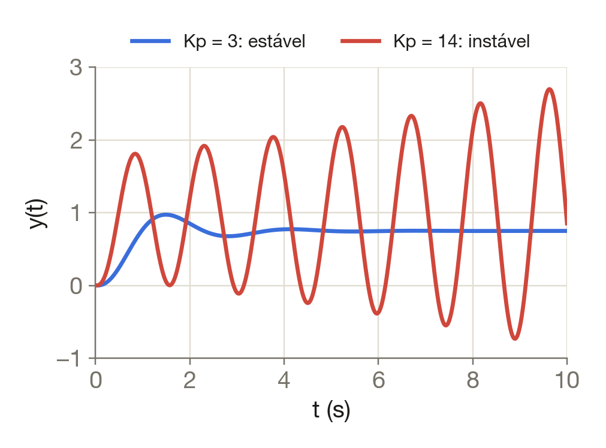
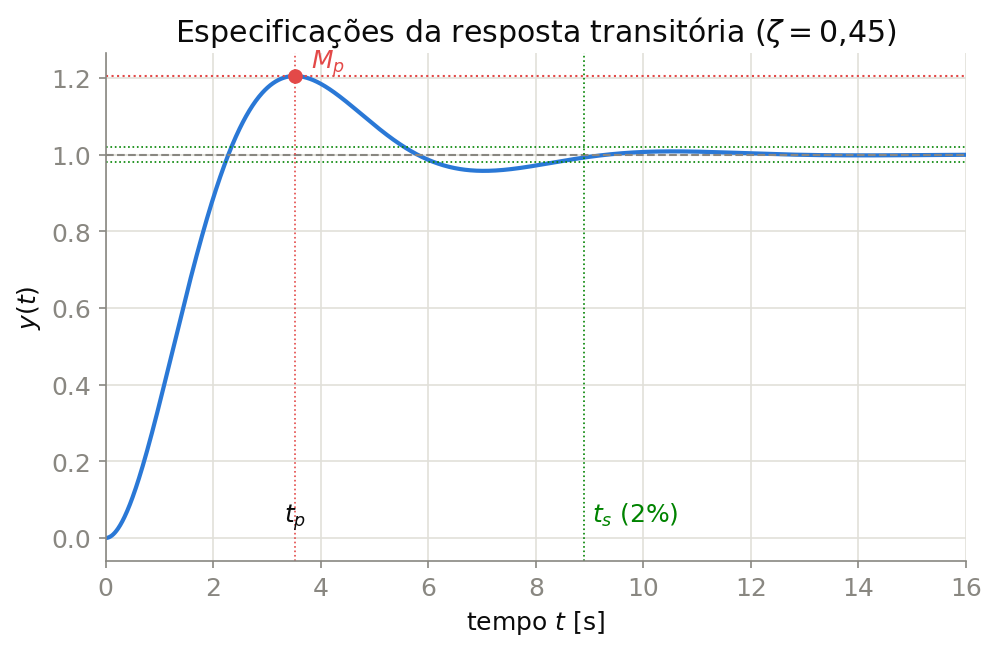

## Ao final desta aula, você será capaz de {.no-crumb}

::: {.big}
1. Explicar o que é um **sistema dinâmico** e por que ele precisa de um **modelo**
2. Distinguir **malha aberta** de **malha fechada** e justificar quando usar cada uma
3. Identificar **referência, erro, controle, saída, perturbação e ruído** num sistema real
4. Ler e simplificar **diagramas de blocos** básicos (série, paralelo, realimentação)
5. Reconhecer os três **objetivos de projeto** e o compromisso entre eles
:::

::: {.notes}
Aula de ~100 min. Roteiro: gancho (5) · sistemas dinâmicos (25) · malhas (25) · blocos (25) · objetivos/curso (15) · síntese (5).
Deixe os objetivos visíveis por alguns segundos e volte a eles no resumo.
:::

## Você já é um controlador

::: {.lead}
A água do chuveiro sai fria. Sem pensar, você executa um algoritmo:
:::

::: {.panels}
::: {.panel .fragment}
1 · [medir]{.rn-underline}

[A pele sente a temperatura da água.]{.muted}
:::
::: {.arrow .fragment}
:::
::: {.panel .fragment}
2 · [comparar]{.rn-underline}

[Está mais fria do que você quer.]{.muted}
:::
::: {.arrow .fragment}
:::
::: {.panel .fragment}
3 · [agir]{.rn-underline}

[Você gira o registro um pouco.]{.muted}
:::
::: {.arrow .fragment}
:::
::: {.panel .fragment}
4 · [repetir]{.rn-underline}

[Até a diferença sumir.]{.muted}
:::
:::

::: {.takeaway .fragment}
Medir, comparar, corrigir — e repetir: isso é **realimentação**.
:::

::: {.notes}
Pergunte à turma antes de mostrar os passos: "o que vocês fazem quando a água está fria?". Deixe que eles descrevam o algoritmo.
:::

## Pergunta de aquecimento

::: {.quiz answer="b"}
Qual destes sistemas usa **realimentação**?

- torradeira com temporizador
- ar-condicionado com termostato
- semáforo de tempo fixo
- micro-ondas com tempo programado
:::

::: {.notes}
Votação com as mãos (teclas 1–4 contam). Pergunta-chave para quem errou: "o aparelho mede a grandeza que quer controlar?". A torradeira mede o tempo, não a cor do pão.
:::

# Sistemas dinâmicos

- Memória e energia
- Modelos
- Analogias
- Resposta no tempo

## Estático × dinâmico

::: {.eqx}
:::: {.columns}
::: {.column width="50%"}
#### Estático: responde ao presente

$$
\eq{d}{v(t)} = R\, \eq{b}{i(t)}
$$

::: {.eqx-text .smaller}
A [tensão]{.t-d} no resistor depende só da [corrente agora]{.t-b}. Sem corrente, sem tensão — instantaneamente.
:::
:::
::: {.column width="50%"}
#### Dinâmico: lembra o passado

$$
\eq{d}{v(t)} = \frac{1}{C}\eq{a}{\int_0^t i(\tau)\, d\tau}
$$

::: {.eqx-text .smaller}
A [tensão]{.t-d} no capacitor depende de [toda a corrente que já passou]{.t-a}: ele **armazena energia**.
:::
:::
::::
:::

::: {.takeaway .fragment}
Sistema dinâmico: a saída depende da **história** — há energia armazenada.
:::

::: {.notes}
Peça exemplos de "memória" física: massa (energia cinética), mola, indutor, capacidade térmica, volume de um tanque. Todo armazenador de energia introduz dinâmica.
:::

## Onde a energia fica guardada

| Domínio | Armazena energia | Dissipa energia | Variável típica |
|:--|:--|:--|:--|
| Mecânico (translação) | massa $m$, mola $k$ | atrito viscoso $b$ | posição, velocidade |
| Elétrico | indutor $L$, capacitor $C$ | resistor $R$ | corrente, tensão |
| Térmico | capacidade térmica | resistência térmica | temperatura |
| Hidráulico | volume do tanque | restrição da válvula | nível, vazão |

: Cada armazenador de energia acrescenta uma ordem ao modelo {tbl-colwidths="[24,26,26,24]"}

::: {.callout-insight .fragment}
Contar os armazenadores **independentes** de energia dá a ordem do sistema: um capacitor → 1ª ordem; massa + mola → 2ª ordem.
:::

## Do circuito ao modelo

Circuito RC com entrada $v_e(t)$ e saída $v_C(t)$, condições iniciais nulas:

::: {.eqx .deriv style="--deriv-lhs: 220px; --deriv-rhs: 560px"}
::: {.step}
[$v_e$]{.lhs} [$= R\,\eq{a}{i} + v_C$]{.rhs} [lei das malhas (Kirchhoff)]{.why}
:::
::: {.step .fragment}
[$\eq{a}{i}$]{.lhs} [$= \eq{a}{C\,\dfrac{dv_C}{dt}}$]{.rhs} [corrente no capacitor]{.why}
:::
::: {.step .fragment}
[$v_e$]{.lhs} [$= \eq{b}{RC}\,\dfrac{dv_C}{dt} + v_C$]{.rhs} [substituindo $i$]{.why}
:::
::: {.step .fragment}
[$\eq{b}{\tau}$]{.lhs} [$= \eq{b}{RC}$]{.rhs} [constante de tempo (segundos)]{.why}
:::
:::

::: {.takeaway .fragment}
$\tau\,\dot v_C + v_C = v_e$ — uma equação diferencial de **1ª ordem**
:::

::: {.notes}
Verifique a unidade de RC com a turma: Ω·F = (V/A)·(A·s/V) = s. Isso dá significado físico a τ.
:::

## Da equação diferencial à função de transferência

::: {.morph}
$$
\mv{tau}{\tau}\,\mv{dy}{\dot y(t)} + \mv{y}{y(t)} = \mv{K}{K}\,\mv{u}{u(t)}
$$

$$
\mv{tau}{\tau}\,\mv{dy}{s\,Y(s)} + \mv{y}{Y(s)} = \mv{K}{K}\,\mv{u}{U(s)}
$$

$$
\mv{tau}{(\tau s} \mv{y}{+ 1)\,Y(s)} = \mv{K}{K}\,\mv{u}{U(s)}
$$

$$
\mv{dy}{G(s)} = \frac{\mv{y}{Y(s)}}{\mv{u}{U(s)}} = \frac{\mv{K}{K}}{\mv{tau}{\tau s + 1}}
$$
:::

::: {.muted .smaller .center}
Laplace troca **derivada** por **multiplicação por $s$** (condições iniciais nulas) — assunto da Aula 2
:::

::: {.notes}
A cada clique, os termos deslizam para a nova posição: mostre que nada "aparece do nada". G(s) é só a razão saída/entrada no domínio de s.
:::

## Mesma matemática, físicas diferentes

::: {.eqx}
:::: {.columns}
::: {.column width="50%"}
$$
\eq{a}{m}\,\ddot x + \eq{b}{b}\,\dot x + \eq{c}{k}\,x = \eq{d}{F(t)}
$$

```{tikz}
%| echo: false
%| fig-align: center
%| out-height: "250px"
%| fig-ext: svg
%| engine-opts: !expr list(classoption = "tikz,dvisvgm", dvisvgm.opts = "--no-fonts", extra.preamble = c("\\usetikzlibrary{arrows.meta,positioning,decorations.pathmorphing}"))
\input{imgs/tikz/MassaMolaAmortecedor.tikz}
```

:::
::: {.column width="50%"}
$$
\eq{a}{L}\,\ddot q + \eq{b}{R}\,\dot q + \eq{c}{\tfrac{1}{C}}\,q = \eq{d}{v(t)}
$$

```{tikz}
%| echo: false
%| fig-align: center
%| out-height: "250px"
%| fig-ext: svg
%| engine-opts: !expr list(classoption = "tikz,dvisvgm", dvisvgm.opts = "--no-fonts", extra.preamble = c("\\usetikzlibrary{arrows.meta,positioning,decorations.pathmorphing}"))
\input{imgs/tikz/CircuitoRLC.tikz}
```

:::
::::

::: {.eqx-text .smaller}
[Inércia]{.t-a}, [dissipação]{.t-b}, [armazenamento elástico]{.t-c} e [excitação]{.t-d}: o mesmo modelo de 2ª ordem descreve os dois sistemas.
:::
:::

::: {.notes}
Passe o mouse em cada termo: o par análogo acende nas duas equações. Pergunta: "o que faz o papel da massa no circuito?" (o indutor: resiste a variações de corrente como a massa resiste a variações de velocidade).
:::

## Experimente: o circuito RC

::: {.pyrun}
```python
import numpy as np
import matplotlib.pyplot as plt

R, C = 10e3, 100e-6        # ohms, farads — mude e execute
tau = R * C
t = np.linspace(0, 5 * tau, 500)
vC = 1 - np.exp(-t / tau)  # degrau de 1 V

plt.plot(t, vC)
plt.axhline(0.632, ls="--", c="gray")
plt.axvline(tau, ls="--", c="gray")
plt.xlabel("t (s)"); plt.ylabel("v_C (V)")
print(f"tau = {tau:.3f} s  ->  63,2 % em t = tau")
```
:::

::: {.muted .smaller}
Dobre $R$: o que acontece com $\tau$ e com a curva? Python roda no navegador (precisa de internet na primeira execução).
:::

## Como um sistema dinâmico responde

::: {style="height: 690px"}
<canvas class="nova-canvas" data-nova-anim="respostas" data-controls="tau,zeta,wn"></canvas>
:::

<script src="anims/nova-anim.js"></script>
<script src="anims/respostas.js"></script>

::: {.notes}
Prévia das Aulas 3 e 4: não deduza nada aqui. Mostre que τ governa a 1ª ordem e que ζ, ωn governam a 2ª. Mexa em ζ e pergunte o que muda no sobressinal.
:::

# Malha aberta e malha fechada

- Malha aberta
- Realimentação
- Robustez × estabilidade

## Malha aberta

::: {.nova-svg data-nova-diagram="malha-aberta"}
:::

<script src="anims/diagramas.js"></script>

::: {.columns .small}
::: {.column width="50%"}
- **Vantagens:** simples, barata, sem sensor
- Funciona bem quando o **modelo é preciso** e não há perturbações
:::
::: {.column width="50%"}
- **Exemplos:** torradeira, máquina de lavar, semáforo de tempo fixo
- Não corrige erros: **não sabe** que errou
:::
:::

## Malha fechada (realimentação)

::: {.nova-svg data-nova-diagram="malha-fechada"}
:::

<script src="anims/diagramas.js"></script>

::: {.small .center .fragment}
O controlador age sobre o **erro** $e(t) = r(t) - y_m(t)$: mede, compara e corrige continuamente [@nise2015; @dorf2018]
:::

## Aberta × fechada: experimente

::: {style="height: 690px"}
<canvas class="nova-canvas" data-nova-anim="aberta-fechada" data-controls="kreal,d,kp"></canvas>
:::

<script src="anims/aberta-fechada.js"></script>

::: {.notes}
Roteiro sugerido:
1. K real = 1, d = 0: as duas acertam.
2. K real = 1,3 (modelo errado): a malha aberta erra 30 %; a fechada quase não muda.
3. d = −0,5: a aberta não corrige; a fechada reduz o efeito.
4. Kp = 14: a fechada fica instável. Pergunta: "realimentação é sempre boa?"
:::

## Comparação

| | Malha aberta | Malha fechada |
|:--|:-:|:-:|
| Mede a saída? | não | sim |
| Custo e complexidade | baixos | maiores (sensor, controlador) |
| Erro de modelo | erra na mesma proporção | **corrige** |
| Perturbações | não corrige | **atenua** |
| Estabilidade | herda a da planta | **pode instabilizar** |

::: {.takeaway .fragment}
Realimentação não é grátis: ganha-se **robustez**, arrisca-se **estabilidade**.
:::

## Verificação

::: {.quiz answer="b"}
Numa malha fechada com controlador proporcional, aumentar muito o ganho $K_p$ tende a:

- eliminar a necessidade de conhecer o modelo
- reduzir o erro, mas aumentar a oscilação até a instabilidade
- transformar o sistema em malha aberta
- não alterar a resposta
:::

::: {.notes}
Quem marcou A: lembrar que o limite de estabilidade (Kp·K < 12,6 no simulador) depende do modelo. Volte ao slide anterior e mostre.
:::

# Elementos e diagramas de blocos

- Sinais
- Um exemplo guiado
- Álgebra de blocos
- Malha fechada em uma fórmula

## Os sinais de um sistema de controle

::: {.eqx}
:::: {.columns}
::: {.column width="42%"}
$$
\eq{b}{e(t)} = \eq{a}{r(t)} - \eq{d}{y_m(t)}
$$

::: {.eqx-text .smaller}
O [erro]{.t-b} é a diferença entre o que se [quer]{.t-a} e o que se [mede]{.t-d}.
:::
:::
::: {.column width="58%"}
::: {.eqx-defs}
- [$r(t)$]{.t-a} referência (*setpoint*): o valor desejado
- [$e(t)$]{.t-b} erro: o que falta para chegar lá
- [$u(t)$]{.t-c} sinal de controle: o que o controlador manda
- [$y(t)$]{.t-d} saída: a grandeza controlada
- [$d(t)$]{.t-g} perturbação: o que atrapalha de fora
- [$n(t)$]{.t-e} ruído de medição: o que o sensor inventa
:::
:::
::::
:::

## Exemplo guiado: identifique os sinais

| Sinal | Piloto automático (carro) | Chuveiro elétrico com termostato |
|:--|:--|:--|
| $r(t)$ referência | velocidade escolhida | [temperatura desejada]{.fragment} |
| $y(t)$ saída | velocidade real | [temperatura da água]{.fragment} |
| $u(t)$ controle | abertura do acelerador | [potência na resistência]{.fragment} |
| $e(t)$ erro | velocidade desejada − medida | [temperatura desejada − medida]{.fragment} |
| $d(t)$ perturbação | subida, vento | [vazão, água fria da caixa]{.fragment} |
| $n(t)$ ruído | vibração no sensor de roda | [ruído do termistor]{.fragment} |

::: {.notes}
Peça à turma para preencher a coluna do chuveiro antes de revelar cada linha.
:::

## Álgebra de blocos: as três formas básicas

::: {.nova-svg data-nova-diagram="formas-blocos"}
:::

<script src="anims/diagramas.js"></script>

::: {.notes}
Série: as funções de transferência multiplicam. Paralelo: somam. Realimentação: a fórmula que deduziremos no próximo slide.
:::

## A malha fechada em uma fórmula

::: {.eqx .deriv style="--deriv-lhs: 340px; --deriv-rhs: 520px"}
::: {.step}
[$Y$]{.lhs} [$= G\,\eq{c}{U}$]{.rhs} [planta]{.why}
:::
::: {.step .fragment}
[$\eq{c}{U}$]{.lhs} [$= C\,\eq{b}{E}$]{.rhs} [controlador]{.why}
:::
::: {.step .fragment}
[$\eq{b}{E}$]{.lhs} [$= R - H\,Y$]{.rhs} [comparador (sensor $H$)]{.why}
:::
::: {.step .fragment}
[$Y$]{.lhs} [$= GC\,(R - H\,Y)$]{.rhs} [substituindo $U$ e $E$]{.why}
:::
::: {.step .fragment}
[$Y\,\eq{a}{(1 + GCH)}$]{.lhs} [$= GC\,R$]{.rhs} [isolando $Y$]{.why}
:::
:::

::: {.takeaway .fragment}
$$
T(s) = \frac{Y(s)}{R(s)} = \frac{G\,C}{\eq{a}{1 + G\,C\,H}}
$$
:::

## Por que a realimentação atenua perturbações

::: {.eqx}
$$
Y(s) = \eq{d}{\frac{GC}{1 + GCH}}\,R(s) + \eq{g}{\frac{G}{1 + GCH}}\,D(s)
$$

::: {.eqx-text}
A [referência]{.t-d} chega quase inteira à saída quando $GC$ é grande, enquanto a [perturbação]{.t-g} é **dividida** por $1 + GCH$. Ganho alto → perturbação pequena — até o limite da estabilidade.
:::
:::

::: {.callout-insight .fragment}
É exatamente o que o simulador mostrou: aumentar $K_p$ reduziu o efeito de $d$, mas, a partir de certo ponto, a malha oscilou e divergiu.
:::

# Objetivos de projeto e o curso

- Especificações
- História
- Roteiro

## Os três objetivos de projeto

::: {.panels}
::: {.panel}
**1 · Estabilidade**



[a saída não pode divergir]{.muted .small}
:::
::: {.panel .fragment}
**2 · Resposta transitória**



[rapidez e sobressinal]{.muted .small}
:::
::: {.panel .fragment}
**3 · Regime permanente**


[precisão final]{.muted .small}
:::
:::

::: {.takeaway .fragment}
Os três **competem**: todo projeto de controle é um compromisso.
:::

## Um pouco de história

::: {.timeline .incremental}
- **1788** Watt: regulador centrífugo das máquinas a vapor
- **1868** Maxwell analisa a estabilidade dos reguladores [@maxwell1868]
- **1927** Black: amplificador com realimentação negativa
- **1932–45** Nyquist e Bode: resposta em frequência
- **1942** Ziegler e Nichols: sintonia de PID [@ziegler1942]
- **1948** Evans: lugar geométrico das raízes
:::

::: {.takeaway .fragment}
A realimentação é mais antiga que a eletrônica: nasceu regulando máquinas a vapor.
:::

::: {.muted .smaller .center .fragment}
O **controle clássico** (este curso) consolidou-se entre 1930 e 1950 e trabalha no domínio de $s$.
:::

## Roteiro do curso

::: {.timeline}
- **1** Introdução [você está aqui]{.now}
- **2** Modelagem e função de transferência
- **3–5** Resposta de 1ª e 2ª ordem
- **6** Erro de regime permanente
- **7** Lugar geométrico das raízes
- **8** Resposta em frequência
- **9** Controlador PID
:::

::: {.muted .smaller .center}
Bibliografia principal: @nise2015, @ogata2010 e @dorf2018
:::

## Resumo

1. Sistema **dinâmico** tem memória: armazena energia e precisa de um **modelo** (EDO → $G(s)$)
2. Sistemas físicos diferentes podem ter o **mesmo modelo matemático**
3. **Malha aberta** é simples, mas não corrige erros de modelo nem perturbações
4. **Malha fechada** mede, compara e corrige — ao custo de poder **instabilizar**
5. Diagramas de blocos: **série** multiplica, **paralelo** soma, **realimentação** $\Rightarrow \dfrac{G}{1 \pm GH}$

::: {.takeaway .fragment}
Projetar controle é escolher parâmetros que equilibram estabilidade, rapidez e precisão.
:::

## Exercícios

1. Cite três sistemas de controle do seu cotidiano e classifique-os em malha aberta ou fechada. Justifique.
2. Para um forno elétrico com termostato, identifique $r(t)$, $y(t)$, $u(t)$, $e(t)$, $d(t)$ e $n(t)$ e desenhe o diagrama de blocos.
3. Deduza a equação diferencial e a função de transferência de um circuito RL série (entrada: tensão; saída: corrente). Qual é a constante de tempo?
4. Reduza a um único bloco: $G_1$ e $G_2$ em série, realimentados por $H$ (realimentação negativa).
5. No simulador "aberta × fechada", encontre o menor $K_p$ que torna a malha instável e compare com $K_p\,K < 12{,}6$. O que muda se o ganho real for $K = 1{,}5$?
6. Pesquise o regulador centrífugo de Watt: identifique nele sensor, atuador e referência.

## Referências {.nova-refs-slide .no-cites}

::: {#refs}
:::


